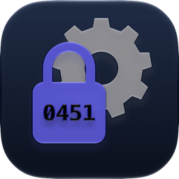
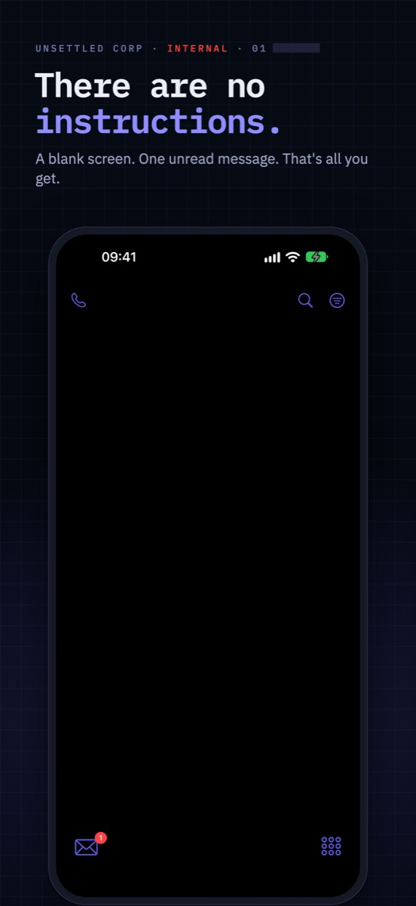
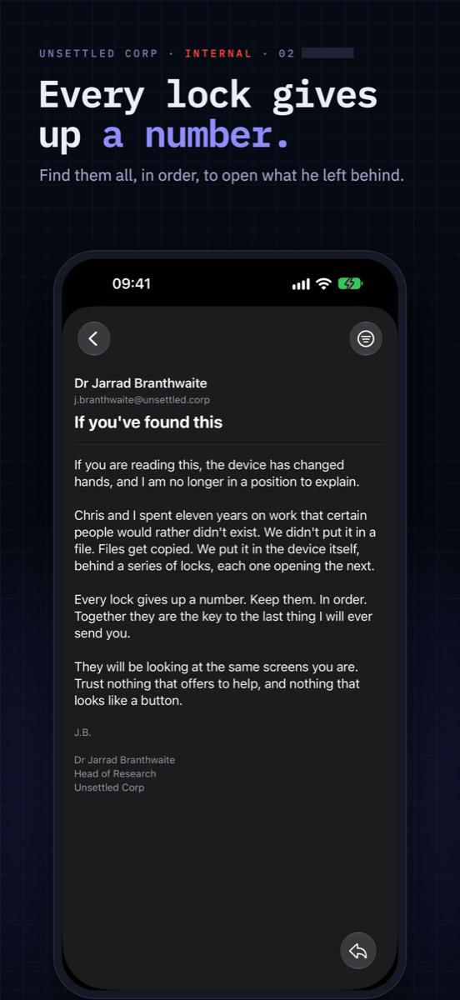
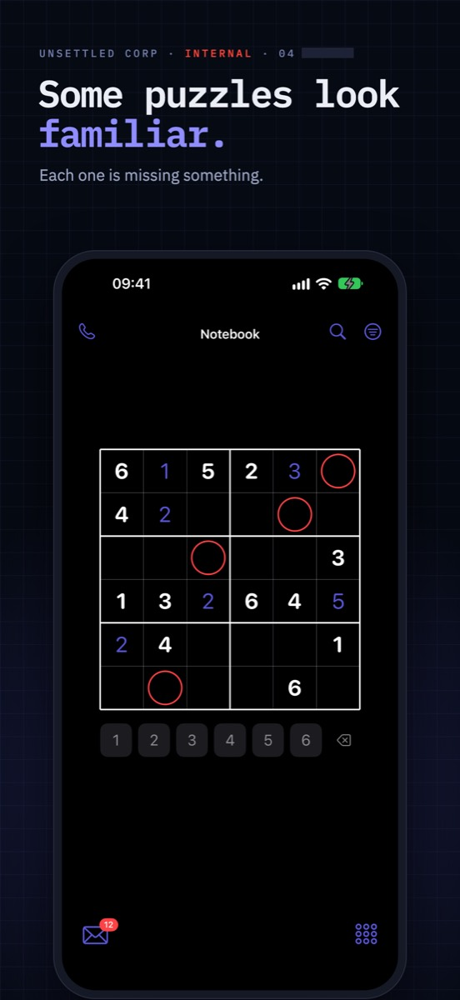
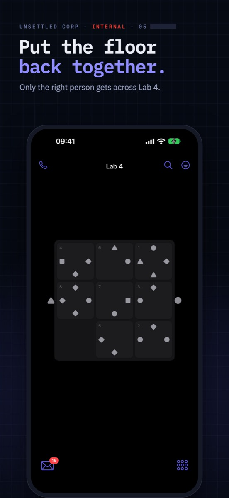
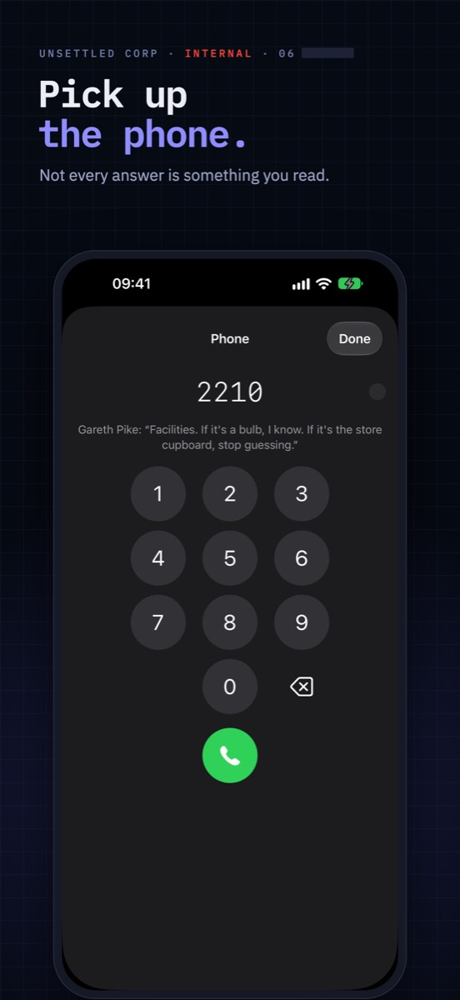
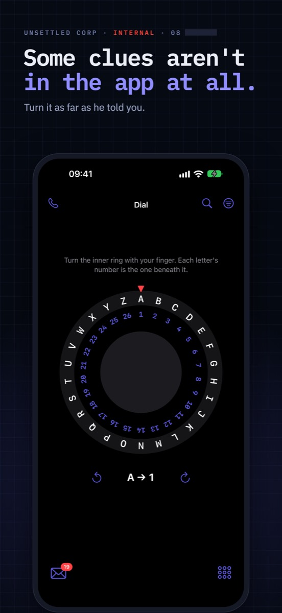

  

<h1 align="center">Unsettled: Impossible Escape</h1>

  <strong>A spy puzzle hidden in a phone.</strong> 
  <a href="https://unsettled.thechels.uk/">unsettled.thechels.uk</a> ·
  <a href="https://apps.apple.com/gb/app/unsettled-impossible-escape/id6819058615">Download free on the App Store</a>

---

> There are no instructions. There is no way back.

**Unsettled** is an escape room game for iPhone, disguised as an ordinary-looking phone. The screen is blank. A mail icon has one unread message. Each message from Unsettled Corp is a level: a cipher, a code or a riddle whose answer is a number. Most people never get past the first message. Will you?

  
  
  

## The story

Dr Jarrad Branthwaite and Chris Wood spent eleven years on work that certain people would rather didn't exist. They didn't put it in a file. They hid it in this phone, behind a chain of locks. Every lock gives up a number. Find them all, in order, and they open the message they left behind. Then wait for Chris.

## How it plays

1. **Read.** Each message is a puzzle. Read it, read between the lines, and scroll to the bottom.
2. **Enter.** Every answer is a number. Enter it on the keypad. The controls on screen are real, but most of them are decoys.
3. **Look further.** Some puzzles use the phone itself. Some clues don't live in the app at all.
4. **No freebies.** There's no tutorial and no free hint. Every five levels earns you one.

If you love cryptic crosswords, escape rooms, ciphers, Morse code, logic puzzles and detective mysteries, this is the hardest puzzle game on your phone.

## Three chapters, thirty-five locks

| Chapter | | |
|---|---|---|
| **1: The first lock** | Free | Ends with a sealed message. |
| **2: A day later** | Free | Starts a day after chapter one, in real time, and ends with another sealed message. |
| **3: Someone has been watching** | £2.99 one-off | Fifteen harder locks, a little French, and the truth about who has been writing to you. |

Stuck for good? Three extra hints cost £0.99.

  
  
  

## Private by design

No account. No ads. No tracking. Nothing leaves your phone. Notifications and motion are used only by the puzzles that need them, and only on your device. Read the [privacy policy](https://thechels.uk/app/privacy).

## Requirements

- iPhone with iOS 18 or later
- Free to download; hints and chapter three are optional in-app purchases
- Made in the UK

## FAQ

**Is Unsettled really impossible?**
No, but it is hard. Every level is tested to have exactly one answer, and everything you need is already in front of you.

**Is there a walkthrough?**
No. That's the point. Earn hints by solving levels, or buy a hint pack if you're truly stuck.

**Is it suitable for escape room fans?**
Yes. Unsettled is a digital escape room where the room is a phone: ciphers, hidden clues and misdirection, with a spy story told through sealed messages.

  

---

## About this repository

This repository is the source of [unsettled.thechels.uk](https://unsettled.thechels.uk/), a static HTML and CSS site deployed to GitHub Pages by [`.github/workflows/pages.yml`](.github/workflows/pages.yml) on every push to `main`. Dependabot keeps the workflow's actions up to date.

© 2026 Unsettled · [thechels.uk](https://thechels.uk/)
